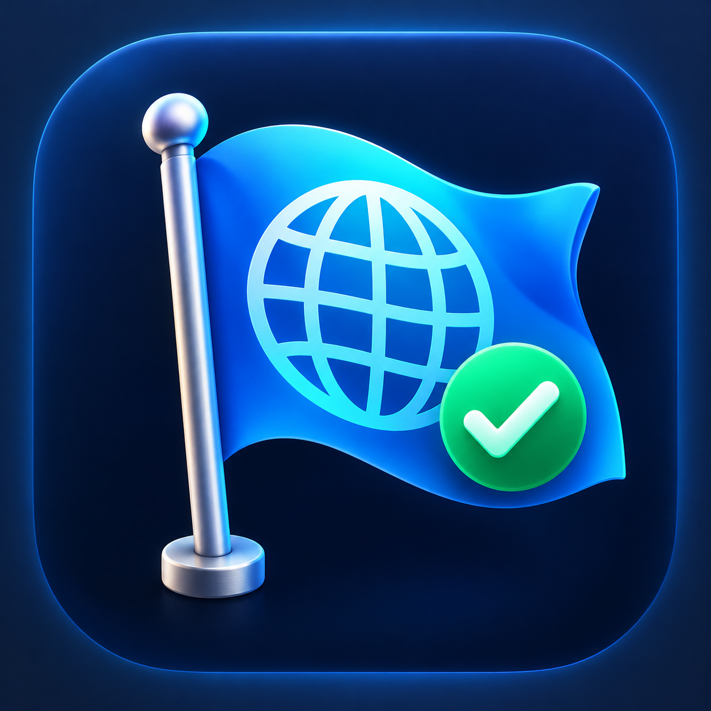
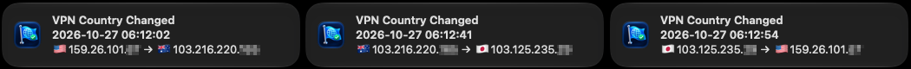

<p align="center">
  
</p>

<h1 align="center">VPN Country Flag</h1>

<p align="center">
  <strong>See where your internet traffic exits — right from the macOS menu bar</strong>
</p>

<p align="center">
  <a href="https://crustylabs.ai/">
    
  </a>
  
  
  
</p>

---

VPN Country Flag is a small native macOS menu-bar app for travelers, digital
nomads, and security-minded people who want immediate visual confirmation that
their internet exit location has changed.

Connect to a VPN and the flag changes. Disconnect and it changes back. No map,
dashboard, account, or subscription — just the information you need at a
glance.

## Features

| | Feature | Description |
|---|---|---|
| 🌍 | **Country at a glance** | Shows the country associated with your current public IP as a menu-bar flag |
| 🔄 | **Automatic detection** | Refreshes when macOS reports a network change, including many VPN connections and disconnections |
| ⏱️ | **Backup refresh** | Optionally checks every 1, 5, or 15 minutes when a network change is not reported |
| 🔔 | **Change notifications** | Shows a timestamped notification when the public IP or country changes |
| 🔊 | **Optional sound** | Plays a notification sound when the exit changes |
| 📋 | **Quick copy** | Copies the current public IP from the menu |
| 🖧 | **Local addresses** | Lists active local IPv4 and IPv6 interface addresses |
| 🚨 | **Visible failure state** | Shows 🆘 only when both lookup providers fail |
| 🔐 | **Quiet refreshes** | Keeps the current flag in place while refreshing — no distracting “Resolving…” text |
| 🚀 | **Launch at login** | Starts automatically with macOS when enabled |

## Notification Format

When your exit changes, VPN Country Flag reports exactly what changed:

```text
Public IP Changed
2026-10-27 05:07:56
🇺🇸159.26.101.xxx → 🇺🇸159.26.101.yyy
```

If the country changes, the notification title becomes **VPN Country Changed**.

## Screenshots

<p align="center">
  
  <br><em>After installing and launching the app, choose <strong>Test notification</strong> from the menu to confirm that notifications and sound are working.</em>
</p>

<p align="center">
  
  <br><em>A globetrotting test: United States → Australia → Japan → United States.</em>
</p>

## Installation

1. Download the latest build from the repository's **Releases** page.
2. Move **VPN Country Flag.app** to `/Applications`.
3. Control-click the app and choose **Open** on first launch.
4. Open **Preferences** from the flag menu to configure refreshes,
   notifications, sound, and launch at login.

Personal builds are ad-hoc signed. Until the app is signed and notarized through
the Apple Developer Program, macOS may require the Control-click → **Open** step
after downloading it.

## Usage

1. Launch VPN Country Flag. Your current exit-country flag appears in the menu bar.
2. Connect or disconnect your VPN.
3. Watch the flag update and, when enabled, receive a timestamped notification.
4. Click the flag to inspect or copy the public IP, view local addresses, refresh
   manually, or open Preferences.

The default menu-bar format shows only the emoji flag. Preferences can also show
the country code, country name, IPv4 address, or IPv6 address.

## How It Works

VPN Country Flag asks a public IP geolocation service which IP address made the
request and which country that address is associated with. It uses `ipwho.is`
first and `ipapi.co` as a fallback. The returned two-letter country code is
converted locally into a flag emoji.

The last successful result is cached. During an ordinary refresh, the existing
flag remains visible. If both services fail, the menu-bar item changes to 🆘 and
the error is available in the menu.

## Privacy

- No account is required.
- The app has no analytics or application-specific backend.
- The lookup providers necessarily see the public IP making the request.
- Local interface addresses remain on the Mac.
- Preferences and the last successful result are stored locally with
  `NSUserDefaults`.

## What It Does Not Validate

VPN Country Flag confirms the public IP and its estimated country. It does not
prove that a VPN tunnel is encrypted, test a kill switch, detect DNS or WebRTC
leaks, or guarantee the physical location of a server. IP geolocation identifies
the approximate registered location of an address and can occasionally be wrong.

## Requirements

- macOS 13 Ventura or later
- Apple silicon or Intel Mac
- Internet access to at least one configured lookup provider

## Building from Source

Install Apple's Command Line Tools, then run:

```sh
git clone https://github.com/steveshannon/VPN-Country-Flag.git
cd VPN-Country-Flag
./build.sh
open "dist/VPN Country Flag.app"
```

The build script compiles a universal AppKit executable, assembles the `.app`
bundle, and applies an ad-hoc signature. A paid Apple Developer identity is
required for Developer ID signing, notarization, or Mac App Store submission.

## Contributing

Bug reports, ideas, and pull requests are welcome. Please describe the behavior
you observed, your macOS version, Mac architecture, VPN client if relevant, and
the result you expected.

## Project Home

VPN Country Flag is a [CrustyLabs.ai](https://crustylabs.ai/) project — practical
tools that cut through the noise.

## License

Licensed under the [Apache License 2.0](LICENSE). Redistribution and derivative
works must retain the license and applicable attribution notices in [NOTICE](NOTICE).

---

<p align="center">
  Built for people who want to know where their traffic is going.
</p>
